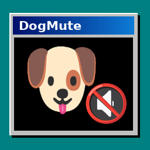
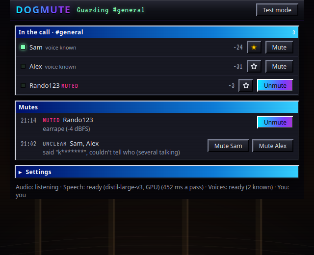
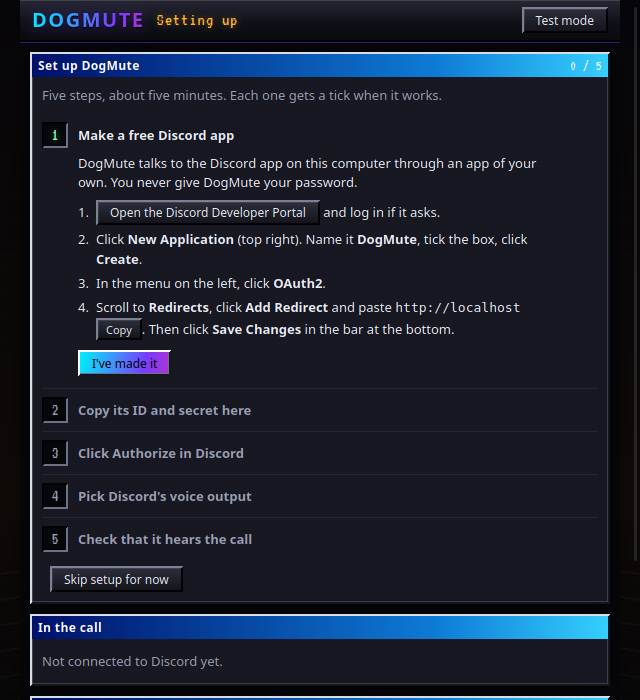
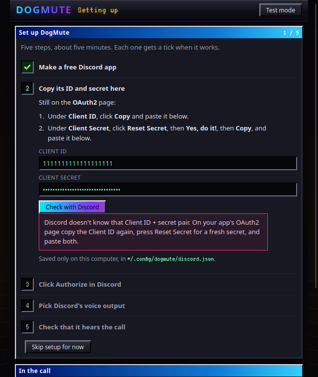
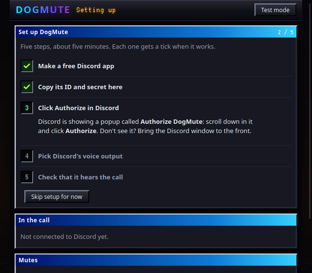
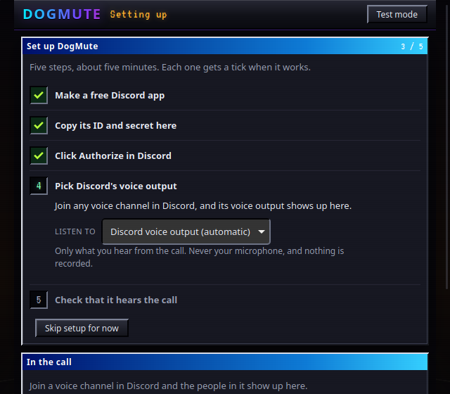
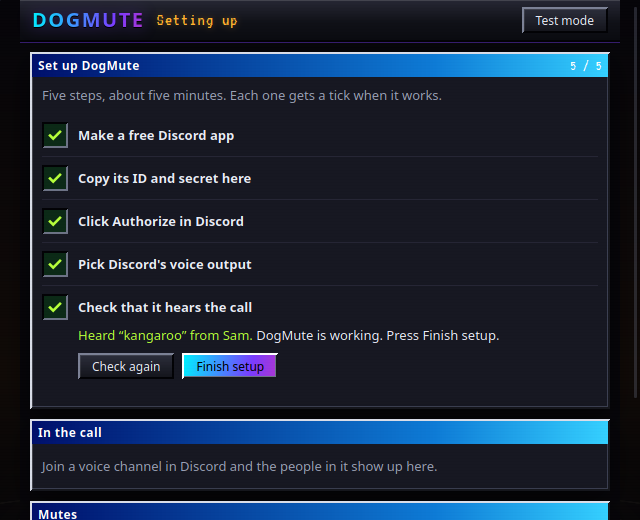

# DogMute

Automatic **local mute** for Discord voice calls. When someone in your call says a slur or blasts mic spam, DogMute
mutes them **for you only**, using Discord's own per-user mute (right-click someone > Mute). You don't need to be a moderator.
No bot joins the server, and nobody else can see anything.

It runs on your computer (Linux or macOS): it listens to the call audio Discord plays to you, turns speech into text
offline, and asks the Discord app to mute the person who said a word on your list, or who is blasting noise.



## Quick start

1. Open the **Discord desktop app** and log in.
2. Run: `curl -fsSL https://raw.githubusercontent.com/dogsaredogsnthatscool/dogmute/main/install.sh | bash`
   (or `git clone` this repo and run `./install.sh`). It checks your computer and tells you how to fix anything missing.
3. Your browser opens **http://127.0.0.1:8853**. Follow the 5 numbered steps; each gets a tick when it works.
4. Join a voice call. That's it: DogMute runs in the background and starts by itself when you log in.
5. Stuck? See [Troubleshooting](#troubleshooting).

### On a Mac

macOS 13 Ventura or newer. Apple Silicon runs the accurate speech model on its GPU (macOS 14+); Intel Macs use the CPU.

1. Install [Homebrew](https://brew.sh) and the Xcode Command Line Tools (`xcode-select --install`), then
   `brew install python@3.13`.
2. Open the **Discord desktop app** and log in.
3. In Terminal, run the same command:
   `curl -fsSL https://raw.githubusercontent.com/dogsaredogsnthatscool/dogmute/main/install.sh | bash`
4. Follow the 5 steps on the page. At step 4 macOS asks whether **Python** may record the screen and system audio.
   That's DogMute hearing Discord (it keeps no picture and never opens your microphone). Click **Open System Settings**,
   turn on **Python** under **Privacy & Security → Screen & System Audio Recording**, then click **Restart DogMute** on
   the page.

DogMute uses Apple's ScreenCaptureKit to hear only the Discord app, so no audio driver is needed. If you'd rather not
give that permission, use [BlackHole](#blackhole-instead-of-screen-recording) instead.



## What it catches

- **Words on your list.** Slurs by default. Stretched spellings (`wooord`), leetspeak (`w0rd`), plurals and
  `w**d`-style censoring all count. You can edit the list.
- **Earrape.** Very loud or clipping audio held for a moment.
- **Sudden blasts.** Audio far louder than that person's own normal voice.
- **Nonstop noise or music.** A mic that stays open for 20 s or more with none of the gaps speech has.
- **Mic on/off spam.** The mic flicking on and off many times in a few seconds.

Every limit can be changed on the page.

## Safety valves

- **Friends:** star someone and they are never auto-muted.
- **One-click Unmute:** next to each person, and next to each entry in the log ("muted X for Y at Z").
- **Auto-unmute** after N minutes (off by default).
- **Test mode:** logs who it *would* mute and mutes nobody.
- **Bots are left alone** by default, because music bots play nonstop on purpose.
- **Unclear cases are skipped.** When it can't tell who said a word, nobody gets muted. The log shows the
  candidates with a Mute button for each.

## How it works

| Part | What it does |
|---|---|
| Discord connection | Discord's official **local RPC** (the `discord-ipc-0` socket the desktop app opens: in `$XDG_RUNTIME_DIR` on Linux, Flatpak and Snap too, or in `$TMPDIR` on macOS), with your own Discord app and the scopes `rpc rpc.voice.read rpc.voice.write`. It gets who is in your channel and who is speaking when (`SPEAKING_START/STOP`), and mutes with `SET_USER_VOICE_SETTINGS {mute: true}`. |
| Audio | Linux: `pw-record` attached only to Discord's playback stream (`playStream`) in PipeWire. macOS: a small Swift helper (`mac/listen.swift`, built by the installer) that takes only the Discord app's sound through ScreenCaptureKit, or reads a BlackHole loopback device. Either way it's the mix you hear, never your microphone, and it stays in a 30 s buffer in memory. |
| Speech to text | [faster-whisper](https://github.com/SYSTRAN/faster-whisper): `distil-large-v3` on an NVIDIA GPU (about 0.5 s per pass), or `base.en` on the CPU. On Apple Silicon, [mlx-whisper](https://github.com/ml-explore/mlx-examples/tree/main/whisper) runs `distil-large-v3` on the Mac's GPU through Metal, with faster-whisper on the CPU as the fallback. While anyone talks, the last 6 s are transcribed about once a second. |
| Who said it | Each word's timestamp is lined up with Discord's speaking events. If several people talk at once: someone with an open mic counts as background, and otherwise the voice decides. A [WeSpeaker](https://github.com/wenet-e2e/wespeaker) ResNet34 speaker embedding (ONNX, CPU) is learned from moments each person talks alone. |
| Noise rules | Loudness in 50 ms slices, counted only while exactly one person is talking. |
| Page | A small local page at `http://127.0.0.1:8853` (Python's built-in HTTP server). Only same-origin JSON requests are accepted, so other websites can't drive it. |

## Privacy

- Audio stays in memory and is never written to disk.
- Transcripts are checked against your list and dropped right away. They are never stored or logged.
- Voice profiles stay in memory for the current call only. They are cleared when you leave or switch channels, and when
  DogMute stops.
- The only thing written to disk is the mute log, `~/.local/state/dogmute/mutes.jsonl`: time, person, and a reason with
  the word starred out (`said "k*******"`). The service log (the systemd journal, or `~/Library/Logs/dogmute.log` on
  macOS) holds the same mute lines and errors, never what people said.
- Nothing is sent anywhere. The exceptions are Discord's own OAuth token endpoint (once, to log your app in), the
  one-time model downloads from Hugging Face, and the overlay hook if you switch it on.

Recording other people without their consent is illegal in some places (California, for example). DogMute never
records.

## Requirements

- **Linux** with **PipeWire** (`pw-record` and `pw-dump`), or **macOS 13+** with Homebrew and the Xcode Command Line
  Tools (to build the sound helper).
- The **Discord desktop app** (on Linux: native, Flatpak or Snap).
- **Python 3.12+** (tested on 3.14 on Linux; the installer picks 3.13 on a Mac).
- Optional: an **NVIDIA GPU** with the CUDA 12 cuBLAS library (`libcublas.so.12`), or an **Apple Silicon** Mac on
  macOS 14+, for the big speech model. Without one it runs on the CPU with a smaller model.
- Optional: `python3-gi` + WebKit2GTK 4.1 for the app window (otherwise use a browser), `notify-send` for pop-ups,
  `espeak-ng` for the full test suite.
- Disk: about 1.6 GB for models on the GPU setup (distil-large-v3), about 200 MB on CPU only. They are downloaded on
  first start into `~/.cache/huggingface`.

## Install

```bash
git clone https://github.com/dogsaredogsnthatscool/dogmute.git
cd dogmute
./install.sh            # --desktop: also a Desktop launcher · --no-service: don't run in the background
```

The installer:
- Works out whether it's on Linux or macOS and checks what that needs (Linux: Python, PipeWire, systemd, your graphics
  card; macOS: the macOS version, Homebrew, Python, the Xcode Command Line Tools, Apple Silicon). It also checks for
  the Discord app. Anything missing gets a one-line fix.
- Makes `.venv` with pinned dependencies (plus mlx-whisper on Apple Silicon), and on macOS builds `bin/dogmute-listen`.
- Downloads the speech and voice models once.
- Starts DogMute in the background at login and waits for Discord: a systemd **user** service (`dogmute`) on Linux, a
  launchd agent (`~/Library/LaunchAgents/local.dogmute.plist`) on macOS.
- On Linux, adds **DogMute** to your app menu. Then it opens the setup page.

To remove it, run `./install.sh --remove`. Your settings stay in `~/.config/dogmute`.

## Setup (the 5 steps on the page)

DogMute talks to the Discord app through your own free Discord application, so it never sees your password. The page
walks you through it:

| | |
|---|---|
|  | **1. Make a free Discord app.** Open the [Developer Portal](https://discord.com/developers/applications) → **New Application** → name it, tick the box, **Create** → **OAuth2** in the left menu → under **Redirects**, **Add Redirect** `http://localhost` → **Save Changes**. |
|  | **2. Copy its ID and secret.** On the same OAuth2 page, copy the **Client ID**, then **Reset Secret** → **Yes, do it!** → **Copy**. Paste both. DogMute checks them with Discord right away and tells you what to fix if they're wrong. |
|  | **3. Click Authorize in Discord.** A popup opens inside the Discord app. If you cancel it, or it never shows, the page says why and offers **Try again**. |
|  | **4. Pick Discord's voice output.** It's found automatically once you're in any voice channel. You can choose another app's sound if you call from somewhere else. On a Mac, this is where macOS asks to let **Python** record the screen and system audio: the step shows **Open System Settings** and **Restart DogMute** buttons until it's allowed. |
|  | **5. Check that it hears the call.** Press **Start the check** and ask someone in your call to say "kangaroo". Nobody gets muted during the check. |

The ID, secret and Discord tokens are saved only on your computer, in `~/.config/dogmute/discord.json` (mode 600).
The RPC voice permissions work for the app's owner without Discord's review. To use one app on several accounts, add
those accounts under **App Testers** in the developer portal. **Settings → Run setup again** brings the steps back.

## Using it

Join a voice call. The page lists everyone in your channel, with a light that is on while they talk and their loudness
level. Each person has a ★ (friend) and a Mute/Unmute button. Below that is the log of mutes.

Setup step 5 is the easiest way to check it works, and you can run it again any time from **Settings → Run setup again**.

## Settings

Everything is on the page under **Settings**, and changes apply right away. They are saved in `~/.config/dogmute/config.json`.

- **Muting:** test mode, auto-unmute minutes, leave bots alone, desktop pop-ups.
- **Words:** listening on/off, speech model, where it runs (auto / graphics card / CPU), CPU threads, voice matching,
  open-mic time, and the who-said-it window. Making that window bigger catches more, but blames the wrong person more often.
- **Noise and mic spam:** earrape level and how long it has to last, clipping %, sudden-blast dB, nonstop-noise
  seconds / level / gap %, and mic on/off count per 10 s. The level numbers next to people in the call help you set these.
- **Overlay hook** (below).
- **Friends** list, and the **page port** (needs a restart, which is a button on the page).

### Word list

The list you edit is `~/.config/dogmute/words.txt` (or the page's editor). Each line is one of these:

```text
word          matches the word, stretched (wooord), leetspeak (w0rd), plural s/z
two words     matches the phrase
word*         anything starting with it
/regex/       a raw regex on the cleaned, lowercased transcript
# comment
```

The default list ships base64-encoded in `dogmute/data/words.default.b64`, so the source code doesn't display slurs. It
is written out as plain text to `words.txt` on first run. To read the default list:
`base64 -d dogmute/data/words.default.b64`.

### Overlay hook

When it's on, every mute is POSTed as JSON to the address you set, for example to drive a stream overlay or a camera effect:

```json
{"cmd": "killfeed", "event": "mute", "name": "SomeUser", "by": "you", "reason": "said \"k*******\"",
 "clip": "", "key": "green", "hit_at": 0.0}
```

`clip`, `key` and `hit_at` are hints for overlays that play a video:
- `clip` is a file from your clip folder, with an optional prefix.
- `key` is `green` for a green screen, `screen` for black dropping out, or `full`.
- `hit_at` is when the hit lands, in seconds.

**Add a clip…** copies a video into the clip folder and can then run your own sync command, for example `rsync`.

### BlackHole instead of screen recording

On a Mac you can skip the screen-recording permission with the free [BlackHole](https://github.com/ExistentialAudio/BlackHole)
loopback driver:

1. `brew install blackhole-2ch`, then restart the Mac.
2. Open **Audio MIDI Setup**, click **+** → **Create Multi-Output Device**, and tick your speakers or headphones and
   **BlackHole 2ch**.
3. In Discord, **User Settings → Voice & Video → Output Device**: pick that Multi-Output Device.
4. On DogMute's page, step 4 (or **Settings → Run setup again**): **Listen to** → **BlackHole 2ch (loopback device)**.
   macOS asks to let Python use the microphone, because it treats BlackHole as one. DogMute only opens loopback
   devices (BlackHole, Loopback, Soundflower), never a real microphone.

## Limits

- Discord gives DogMute **one mixed audio stream**, not one per person, so it works out who said a word from timing
  and voice. When several open mics overlap and it isn't sure, nobody gets muted and the log says why.
- English only. Speech-to-text mistakes happen: words can be misheard, or not heard at all.
- Local mutes are stored by Discord. Someone stays muted until you unmute them (DogMute's Unmute button, or Discord's
  right-click menu) or until auto-unmute kicks in.
- macOS 15+ asks again every month whether Python may keep recording the screen and system audio. Allow it again.

## Troubleshooting

| What you see | What to do |
|---|---|
| Step 3 says **"Open the Discord desktop app"** and never moves on | DogMute looks for Discord's local socket, `discord-ipc-0`, in `$XDG_RUNTIME_DIR` (native app), `$XDG_RUNTIME_DIR/app/com.discordapp.Discord/` (Flatpak) or `$XDG_RUNTIME_DIR/snap.discord/` (Snap). Make sure Discord is open and logged in. Discord in a web browser has no socket. Check with `ls $XDG_RUNTIME_DIR/discord-ipc-* $XDG_RUNTIME_DIR/app/*/discord-ipc-*`. |
| **Flatpak vs .deb** | Both work. If you have both installed, run only one. When both run, DogMute talks to the .deb (native) one. |
| **The Authorize popup never appears** | Bring the Discord window to the front: the popup opens inside it. Then press **Try again**. If it still doesn't appear, fully quit Discord (tray icon → Quit), start it again, and press **Try again**. |
| **"Discord wants a redirect"** | Your app's OAuth2 page needs `http://localhost` under **Redirects**. Remember **Save Changes**. |
| **"Discord doesn't know that Client ID + secret pair"** | Copy the Client ID again, press **Reset Secret** for a new secret, and paste both. Secrets only show once. |
| Step 4 says **"Join any voice channel"** | Discord only opens its voice output while you're in a call. Join one. If it still isn't found, run `pw-dump \| grep -i playStream`. If that's empty, Discord isn't using PipeWire: install `pipewire-pulse`, then restart Discord. |
| It **missed a word** | Make sure the footer says `distil-large-v3, GPU`. The CPU models miss more slang. The word may also be spelled differently in the transcript, so add a variant to your list (a `/regex/` line works too). |
| It says **"couldn't tell who"** | Several mics were open at once. It learns voices from moments people talk alone, so it gets better during a call. Until then, the log shows a Mute button for each candidate. |
| **Speech runs on the CPU** although you have an NVIDIA card | It needs the CUDA 12 cuBLAS library (`libcublas.so.12`): `sudo apt install libcublas12` or the CUDA 12 toolkit. Then run `./install.sh` again. |
| **Port 8853 is taken** | Set `"port"` in `~/.config/dogmute/config.json`, then `systemctl --user restart dogmute` (macOS: `launchctl kickstart -k gui/$(id -u)/local.dogmute`). |
| **macOS: step 4 says "macOS needs your OK"** | Click **Open System Settings**, turn on **Python** under **Screen & System Audio Recording** (or **Microphone** for BlackHole), then **Restart DogMute**. If Python isn't in the list, click **+** and pick it, or press **Restart DogMute** once so macOS asks again. After a Python update macOS may ask again. |
| **macOS: step 3 never finds Discord** | DogMute looks for `discord-ipc-0` in `$TMPDIR`. Check with `ls $TMPDIR/discord-ipc-*`. If it's empty, fully quit Discord (⌘Q) and open it again. |
| **macOS: Discord found but silent** | Join a voice channel: Discord only plays call audio while you're in one. If it still doesn't hear anything, pick **Every app's sound on this Mac**, or use [BlackHole](#blackhole-instead-of-screen-recording). |
| Anything else | `journalctl --user -u dogmute -n 50` (macOS: `tail -50 ~/Library/Logs/dogmute.log`) shows what DogMute is doing (mute events only, never what people said). |

## Tests

```bash
.venv/bin/pip install -r requirements-dev.txt
.venv/bin/python -m pytest -q
```

No Discord is needed: the RPC and speaking events are mocked, and `tests/test_web.py` drives the page's API.
`python3 scripts/screens.py` re-renders the screenshots in `docs/` from made-up states (it needs `python3-gi` +
WebKit2GTK 4.1). `tests/test_pipeline.py` uses `espeak-ng` to stand in for
people talking and downloads the speech models. It is skipped when `espeak-ng` is missing.

## License

MIT. See [LICENSE](LICENSE).

Third-party parts, downloaded or used at runtime:
- faster-whisper, Whisper and distil-whisper: MIT.
- The WeSpeaker ResNet34 voice model (`Wespeaker/wespeaker-voxceleb-resnet34-LM`): CC BY 4.0.
- The icon uses the dog and muted-speaker glyphs from Noto Color Emoji (SIL OFL 1.1).
- The page loads the VT323 font from Google Fonts (SIL OFL 1.1).
